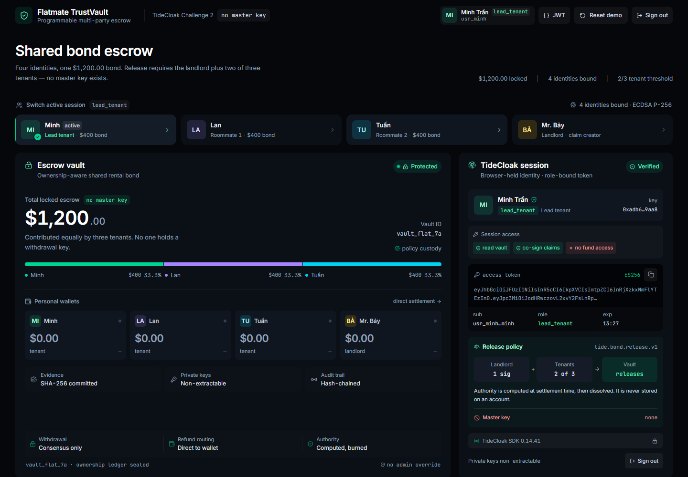
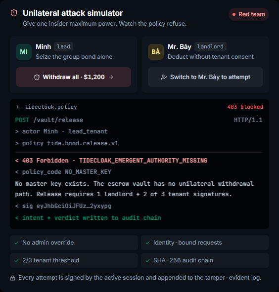
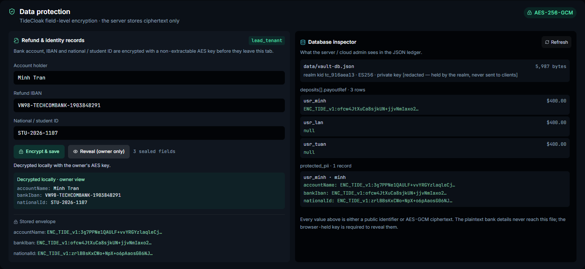

# Flatmate TrustVault

**A $1,200 rental bond that no single person can move.**

TideCloak Challenge 2 · RMIT GenAI & Cybersecurity Hackathon 2026

`Next.js 15` · `TypeScript` · `TideCloak SDK` · `server-verified RBAC` · `AES-256-GCM`



**Judge quick start:** `npm install && npm run dev` → <http://localhost:3000> → choose any identity. No Docker, no passwords, no accounts. The sign-in screen includes a **Judge quick-login credentials** panel with the four seeded identities.

---

## What this build actually verifies

| Pillar | Implementation |
| --- | --- |
| Authentication | Every protected API request carries `Authorization: Bearer <JWT>`. The server verifies the ES256 signature, issuer, audience, expiry and revocation state before reading the ledger. |
| Roles | `tenant`, `lead_tenant`, `landlord` are Realm/Client Roles in the token. Claims are landlord-only, decisions are tenant-only, deposits are tenant-only. Every `/api/vault/*` mutation re-checks the role server-side. |
| No unilateral money | A release needs one landlord claim + two of three tenant approvals. Lead-tenant withdrawal and landlord force-deduct both return a signed `403` policy receipt. No account holds a move-funds scope. |
| Approval signatures | Each browser generates a non-extractable ECDSA P-256 key. Its SPKI public key is bound to the session; every approval is signed in the browser and verified by the server before it counts. |
| Field encryption | Refund IBAN, account name, national/student ID and the landlord's confidential claim note are encrypted with AES-256-GCM **before** upload. The server validates and stores only the ciphertext envelope (rendered as `ENC_TIDE_v1:` in the inspector). |
| Persistence | The vault, wallets, claims, approvals, protected records and revocation list live in `data/vault-db.json`, reachable only through the protected API routes. |
| Transparency | The header opens a raw JWT inspector (header + server-verified payload). The Data protection panel includes a **database inspector** showing exactly what the server and cloud admin can see. |

The demo realm is not a client-side mock: it is a server-side ES256 issuer with a persisted realm key, a JWKS endpoint, `iss`/`aud` validation, Realm/Client Roles and JTI revocation. Tokens are never trusted because they look right; they are verified with the realm public key on every request.



*The lead tenant's attempt to move the whole bond is refused with `403 TIDECLOAK_EMERGENT_AUTHORITY_MISSING`; the policy receipt is signed and added to the audit chain.*

---

## The five questions

### 1. What problem are you solving?

Shared rental deposits are held by one person, usually the lead tenant. Roommates hand over cash and hope. Landlords face the same asymmetry from the other side: they can withhold a bond without evidence. In student share-houses, the "trust me" bond is the norm, and nobody holds a shared record of who paid what.

### 2. What is your solution?

Flatmate TrustVault turns a $1,200 bond into a policy-bound escrow vault. Each tenant's $400 stays cryptographically bound to them. No single wallet, not the lead tenant's and not the landlord's, can move a dollar. Funds are released only when an evidence-backed claim satisfies one written policy: the landlord's signature plus two of three tenant approvals.

### 3. How does TideCloak enable it?

TideCloak supplies identity and authorization. Every persona receives a role-bound ES256 session, and every sensitive action is signed with browser-held keys. The release policy is evaluated from live signatures at settlement time, so authority is computed on demand rather than stored. There is no admin override and no master key to steal.

### 4. What happens when people disagree?

Two tenant rejections block the deduction and engage a partial freeze. The undisputed $1,050 is refunded immediately; only the disputed $150 waits for TideCloak's neutral arbitration panel. The landlord receives nothing in the meantime.

### 5. Why does it matter?

It replaces brokered trust with verifiable consent. Every attempt, including blocked ones, lands in a hash-chained audit trail, giving roommates and landlords one shared source of truth. The same primitive also fits club treasuries, family savings, freelance escrow and on-chain DAO payouts.

---

## Run it locally

Requirements: Node.js 20+ and npm.

```bash
npm install
npm run dev          # http://localhost:3000
```

Production build:

```bash
npm run typecheck
npm run build
npm run start        # http://localhost:3000
```

### Demo identities

| Identity | Role | TideCloak `sub` | Can do |
| --- | --- | --- | --- |
| Minh Trần | `lead_tenant` | `usr_minh` | read the vault, co-sign claims, register encrypted PII |
| Lan Nguyễn | `tenant` | `usr_lan` | read the vault, co-sign claims, register encrypted PII |
| Tuấn Phạm | `tenant` | `usr_tuan` | read the vault, co-sign claims, register encrypted PII |
| Mr. Bảy | `landlord` | `usr_bay` | read the vault, file claims, register an encrypted evidence note |

Deep-link straight into a signed-in persona for capture: `/?as=minh`, `/?as=lan`, `/?as=tuan`, `/?as=bay`.

Sign-out revokes the exact JWT (`jti`) and clears tokens from memory. Signing in again mints a new session; switching personas rotates the token.

### Live TideCloak mode

The client initialises the official `@tidecloak/js` SDK when a live realm is configured, and the server advertises the live issuer. Copy `.env.example` to `.env` and fill in the realm values:

```bash
NEXT_PUBLIC_TIDECLOAK_URL=https://your-tidecloak-host
NEXT_PUBLIC_TIDECLOAK_REALM=tide-demo
NEXT_PUBLIC_TIDECLOAK_CLIENT_ID=flatmate-trustvault
```

**Honest status:** this submission was built and tested without Docker or a provisioned TideCloak realm. The working, server-verified auth path is the built-in demo realm. A production deployment still needs the live OIDC redirect/token-exchange callback and a remote-JWKS verifier; in live mode the demo token endpoint intentionally returns `409 LIVE_REALM` rather than silently falling back. See [Scope](#scope-and-limitations).

---

## Architecture

```text
Browser tab                                  Next.js server (Node runtime)
─────────────────────────────────────       ─────────────────────────────────────────
non-extractable ECDSA P-256 keys  ──────►    /api/auth/token  (demo realm)
AES-256-GCM key (memory only)                /api/vault/*      (JWT + role guard)
encrypt → ciphertext only             ──►    policy engine + signature checks
                                             │
                                             └── data/vault-db.json
                                                 realm key · users · deposits
                                                 wallets · claim · PII ciphertext
                                                 hash-chained audit log
```

### API surface

| Route | Auth | Behaviour |
| --- | --- | --- |
| `POST /api/auth/token` | public (demo realm) | mints a 15-minute ES256 session bound to the browser public key; demo only |
| `GET /api/auth/jwks` | public | realm public key for client-side signature verification |
| `POST /api/auth/logout` | bearer | revokes the token's `jti`; replay returns `401 SESSION_REVOKED` |
| `GET /api/realm` | public | connection card, release policy and four seeded identities |
| `GET /api/vault/state` | any role | redacted snapshot: vault, wallets, claim, approvals, log |
| `POST /api/vault/deposit` | `tenant` / `lead_tenant` | records the caller's $400 share against their `sub` |
| `POST /api/vault/unilateral-attempt` | any role | always refuses; returns a signed policy receipt and the exact error contract |
| `POST /api/vault/claims` | `landlord` only | files an evidence-backed claim with optional encrypted note |
| `POST /api/vault/claims/[id]/decision` | `tenant` only | verifies one ECDSA approval/rejection signature per tenant |
| `GET /api/vault/pii` | bearer | returns **only the caller's** ciphertext record |
| `PUT /api/vault/pii` | bearer | validates AES-GCM envelopes, stores ciphertext, links the encrypted payout reference |
| `GET /api/vault/inspector` | bearer | server-view ledger: ciphertext previews, byte count, users, revoked sessions |
| `POST /api/vault/reset` | bearer | demo-only reset of claim/wallets/log; sessions and encrypted records survive |

Error contracts: `401 UNAUTHENTICATED` / `INVALID_TOKEN` / `SESSION_REVOKED`; `403 FORBIDDEN_ROLE`, `TIDECLOAK_EMERGENT_AUTHORITY_MISSING`, `MISSING_CONSENSUS`, `SIGNATURE_INVALID`.

---

## The demo, step by step

1. **Sign in as Minh** (lead tenant). The raw **JWT** button shows `iss`, `aud`, `sub`, `realm_access.roles` and `resource_access`.
2. Minh tries **Withdraw all · $1,200** → `403 TIDECLOAK_EMERGENT_AUTHORITY_MISSING`, with `callerSub`, `callerRoles` and a signed receipt. The vault does not move.
3. Switch to **Mr. Bảy** (landlord) and try **Force-deduct $300** → `403 MISSING_CONSENSUS`. A landlord alone cannot touch the bond.
4. As Mr. Bảy, file the prefilled **$150 broken faucet** claim. Open **Confidential evidence note**: the note is encrypted in the browser before submission. The inspector shows only `ENC_TIDE_v1:` ciphertext.
5. Switch to **Minh** and sign → **1 / 2**. The vault stays locked.
6. Switch to **Lan** and sign → **⚡ EMERGENT AUTHORITY UNLOCKED**. Atomic settlement: `$150` compensation to Mr. Bảy, `$350` back to each tenant.
7. **Reset demo**, then **Trigger dispute**. Two tenant rejections refund the undisputed `$1,050` immediately and freeze only the disputed `$150`; the landlord receives `$0` while arbitration is pending.
8. In **Data protection**, encrypt Minh's refund IBAN, account name and student ID. The database inspector shows ciphertext for the tenant and the linked deposit; **Reveal (owner only)** decrypts in the same tab. Another identity sees no plaintext.

---

## Data protection model

- AES-256-GCM keys are generated per browser tab/persona and held in a module-level `CryptoKey`; they are never sent to the server.
- Plaintext fields are encrypted before the `PUT /api/vault/pii` request. The server validates the envelope shape and writes it verbatim.
- The landlord's confidential claim note uses the same field-encryption path; the server never sees the plaintext.
- The raw ledger is checked by the automated tests: it contains ciphertext and no plaintext IBAN or national/student ID. The encrypted account-name value exists only inside the ciphertext; public profile display names are separate.
- **Known trade-off:** because the key is memory-only, a full page reload loses the ability to decrypt records written by the previous tab. The ciphertext remains; the owner can re-encrypt fresh demo fields. This is deliberate zero-knowledge behaviour, not a server-side recovery path.



*Left: the owner's in-memory key decrypts the record for display. Right: the server-view inspector sees the same fields only as `ENC_TIDE_v1:` AES-GCM ciphertext.*

---

## Security evidence

Start the dev server, then run any check (Chrome + `playwright-core` are already dev dependencies):

```bash
npm run check:flow          # full 403 → claim → 2/3 → settle → reset → dispute flow
npm run check:auth          # role-specific UI, raw JWT modal, sign-out, deep link
npm run check:api           # 401/403 contracts, revocation replay, owner-only PII
npm run check:pii           # ciphertext in inspector + on disk, owner reveal, isolation
npm run check:claim-note    # encrypted claim note never appears in plaintext
```

They are intentionally adversarial: `api-check` calls the routes with missing, tampered, wrong-role and revoked tokens; `pii-check` reads `data/vault-db.json` directly; `claim-note-check` greps the ledger for the plaintext phrase. The flow script asserts the exact wallet outcomes: `[35000, 35000, 35000, 15000]` after settlement and `[35000, 35000, 35000, 0]` after the dispute.

---

## Scope and limitations

- **Funds are simulated.** No payment rails, bank APIs or real money are connected.
- **The demo realm is a real signer, not a production IdP.** It issues verified ES256 JWTs and enforces RBAC, but it is not a substitute for a hardened OIDC provider. Live TideCloak support is configuration-only in this build (see above).
- **Arbitration is represented** by a frozen balance, case ID and audit entries; there is no separate arbitrator UI or panel workflow.
- **The JSON ledger is single-process** and suitable for a hackathon demo. Production would use a transactional database and a KMS/HSM for the realm key.
- **Reset is a demo control** available to any signed-in identity by design. It preserves encrypted records and deposits so the audit trail is not silently rewritten.
- **The encryption key is memory-only**, so saved ciphertext cannot be revealed after a full reload (see Data protection model).
- The demo evidence photo is a stock image; no real tenant or landlord data is included.

---

## Video

`demo.mp4` (in this repository) is a 1:18 captioned walkthrough of the happy path, both blocked unilateral attempts, the full 2/3 settlement, the dispute freeze and the ciphertext inspector. It is 1440 × 900, 9.2 MB and under two minutes.

---

## Credits

- Evidence photo: free-to-use stock image from [Pexels](https://www.pexels.com/license/), cropped for the demo.
- Icons: [Lucide](https://lucide.dev).
- Fonts: Inter and JetBrains Mono (SIL Open Font License) via `next/font`.
- Built with Next.js 15, React 19, Tailwind CSS v4, `jose`, and `@tidecloak/js` 0.14.41.

## License

MIT — see [LICENSE](LICENSE).
